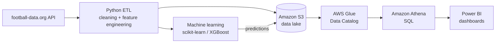

# Premier League Analytics Platform: Project Guide

This document covers what the project set out to do, how the pipeline works, what it is built with, how to run it, and the roadmap. Results, dashboards, and conclusions are in [README.md](README.md).

---

# Objectives

1. **Collect** Premier League match data through a REST API (football-data.org).
2. **Clean and validate** the data so it is analysis-ready.
3. **Engineer leakage-safe features** (rolling form, streaks, goal averages, clean sheet rate, rest days, head-to-head record, prior-season position) that only use information available before each match.
4. **Build a cloud data lake** in Amazon S3, catalog it with AWS Glue, and query it with SQL in Amazon Athena.
5. **Visualize** the data in Power BI dashboards connected to Athena.
6. **Predict match outcomes** (home win, draw, away win) with machine learning, evaluated on a time-based split and reported honestly.
7. **Automate** data refresh with AWS Lambda.

---

# Workflow



| Stage | What happens | Notebook |
|---|---|---|
| 1. Collection | Pull matches and teams for 3 seasons (2023 to 2025) from the API into `data/raw/` | `01_data_collection.ipynb` |
| 2. Cleaning | Flatten nested API fields, keep finished matches, validate team names and IDs, save to `data/processed/` | `02_data_cleaning.ipynb` |
| 3. Exploration | Scoring, defense, home advantage, seasonal trends, upsets | `03_exploratory_analysis.ipynb` |
| 4. Feature engineering | Build leakage-safe rolling features, save to `data/features/` | `04_feature_engineering.ipynb` |
| 5. Upload | Send datasets to S3, one folder per dataset | `05_upload_to_s3.ipynb` |
| 6. SQL analysis | Query the Athena tables | `06_sql_analysis.ipynb` |
| 7. Machine learning | Train and compare models, export predictions | `07_machine_learning.ipynb` |
| 8. Season simulation | Simulate a season with the trained model | `08_season_simulation.ipynb` |
| 9. Dashboards | Power BI pages built on the Athena tables | Power BI Desktop |

## Key design decisions

- **No data leakage:** every rolling feature is shifted so a match's own result is never used to predict it. Rolling and season-to-date features are calculated per team and season, so they reset at each season boundary. Head-to-head win rate is the exception and spans all seasons, because two teams meet only twice per season.
- **Time-based train/test split:** the most recent 20% of matches (222) are held out for testing. A random split would let the model see the future.
- **One S3 folder per dataset:** Athena reads every file under a table's `LOCATION` folder as one table, so datasets that share a folder get merged and produce duplicate rows.
- **Simple model selected:** Logistic Regression matched or beat Random Forest and XGBoost on this data, so the simpler and more interpretable model was kept.

---

# What Was Used

| Layer | Tools |
|---|---|
| Data source | football-data.org API (free tier: 10 requests per minute, most recent 3 seasons only) |
| Data processing | Python, pandas, NumPy, requests, python-dotenv |
| Notebook visuals | Matplotlib, Seaborn |
| Machine learning | scikit-learn (Logistic Regression, Random Forest), XGBoost |
| Cloud | AWS S3, Glue, Athena, IAM, boto3, s3fs, AWS CLI |
| BI | Power BI Desktop, Amazon Athena ODBC driver, DAX |
| Environment | Python virtual environment, Jupyter notebooks in VS Code, Git and GitHub |

---

# How to Run

## 1. Prerequisites

- Python 3 (developed on 3.14)
- An AWS account and an IAM user with S3, Glue, and Athena access
- A free API key from [football-data.org](https://www.football-data.org/client/register)
- Power BI Desktop (Windows) and the Amazon Athena ODBC driver, for the dashboards only

## 2. Install

```bash
python -m venv .venv
```

Activate the virtual environment.

**Windows (PowerShell).** If activation is blocked with a "running scripts is disabled" error, run this first (it applies to the current terminal session only):

```powershell
Set-ExecutionPolicy -Scope Process -ExecutionPolicy Bypass
.venv\Scripts\activate
```

**macOS / Linux:**

```bash
source .venv/bin/activate
```

Then install the dependencies:

```bash
pip install -r requirements.txt
```

## 3. Environment variables

Create a `.env` file in the project root. It is git-ignored and must never be committed.

```
FOOTBALL_DATA_API_KEY=your_api_key_here
AWS_REGION=ap-southeast-2
AWS_S3_BUCKET=your-bucket-name
AWS_ATHENA_OUTPUT_LOCATION=s3://your-athena-results-bucket/
```

AWS credentials (access key ID and secret access key) are **not** stored here. Configure them with `aws configure`.

## 4. AWS setup

1. Create two S3 buckets: one for the data lake and one for Athena query results.
2. Create an IAM user with S3, Glue, and Athena permissions, then run `aws configure` with its access keys and your region.
3. In the Athena query editor, run `CREATE DATABASE IF NOT EXISTS pl_analytics;`
4. Upload the datasets with `05_upload_to_s3.ipynb`.
5. Create an external table for each dataset (example below). Athena runs one statement per query.

**Important:** upload each dataset into its **own S3 folder** (for example `processed/clean_matches/clean_matches.csv`).

<details>
<summary>Example table definition</summary>

```sql
CREATE EXTERNAL TABLE IF NOT EXISTS pl_analytics.clean_matches_multi_season (
    id BIGINT,
    utcDate STRING,
    status STRING,
    matchday INT,
    season STRING,
    home_team_id BIGINT,
    home_team_name STRING,
    away_team_id BIGINT,
    away_team_name STRING,
    home_goals INT,
    away_goals INT,
    winner STRING
)
ROW FORMAT DELIMITED
FIELDS TERMINATED BY ','
LINES TERMINATED BY '\n'
LOCATION 's3://your-bucket-name/processed/clean_matches_multi_season/'
TBLPROPERTIES ('skip.header.line.count'='1');
```

</details>

## 5. Power BI connection

1. Install the Amazon Athena ODBC driver (64-bit).
2. Open the **64-bit** ODBC Data Source Administrator (`C:\Windows\System32\odbcad32.exe`) and add a System DSN using the Athena driver. Set the region, the S3 output location, and IAM Credentials authentication (access key ID as the username, secret key as the password).
3. In Power BI Desktop: **Get Data**, **Amazon Athena**, enter the DSN name, choose **Import**, and select **Use Data Source Configuration** when asked for credentials.

## 6. Run the notebooks

Run the notebooks in the order shown in the workflow table, from inside the `notebooks/` folder (all paths are relative to it). Use the `.venv` kernel, and use **Run All** after a kernel restart so earlier variables are defined again.

---

# Roadmap

| Phase | Status | Notes |
|---|---|---|
| 1. Data collection | Done | 3 seasons, 1,140 matches. The free tier blocks seasons older than the 3 most recent. |
| 2. Data cleaning | Done | Nested API fields flattened, finished matches only, team names validated. |
| 3. Exploratory analysis | Done | Cards, referee, and stadium analysis skipped because the free tier does not provide that data. |
| 4. Feature engineering | Done | Leakage-safe rolling features, reset per season except head-to-head. |
| 5. Upload to S3 | Done | One folder per dataset. |
| 6. Glue and Athena | Done | Database `pl_analytics` with tables for matches, features, and predictions. |
| 7. SQL analysis | Done | Queries on scoring, defense, form, streaks, home/away splits, and clean sheets. |
| 8. Power BI dashboards | Done | Overview, team performance, offensive, defensive, prediction, and season simulation pages. |
| 9. Machine learning | Done | Logistic Regression selected (43.7% accuracy on the held-out test set). |
| 10. Automation (AWS Lambda) | <!-- TODO: set status --> | Function code is in `lambda/lambda_function.py`. |

## Possible extensions

- Predict genuinely upcoming fixtures, using features calculated only from matches already played.
- Add cards, fouls, referee, and venue analysis with a richer data source (for example football-data.co.uk CSVs or a paid API tier).
- CI/CD with GitHub Actions (linting and formatting checks).
- Containerization with Docker.
- A Streamlit front end for predictions.