# Premier League Analytics Platform

An end-to-end analytics pipeline for Premier League match data: collection through a REST API, cleaning and feature engineering in Python, a cloud data lake on AWS (S3, Glue, Athena), Power BI dashboards, and a machine learning model that predicts match outcomes.

> **Looking for setup instructions?** See [PROJECT.md](PROJECT.md) for the objectives, workflow, tools used, roadmap, and how to run the project.

## Highlights

- **1,140 matches** across 3 seasons (2023/24 to 2025/26) and 25 clubs, collected from the football-data.org API.
- **Leakage-safe features:** rolling form, streaks, rolling goal averages, clean sheet rate, rest days, head-to-head record, and prior-season league position. Every feature is calculated from matches played before the one being predicted.
- **Cloud data lake:** datasets stored in Amazon S3, cataloged with AWS Glue, and queried with SQL in Amazon Athena.
- **Power BI dashboards** built on Athena through the ODBC driver, with custom DAX measures.
- **Honest ML evaluation:** a time-based split (888 training matches, 222 held-out test matches). The selected Logistic Regression model scores **43.7%** accuracy on three-way outcome prediction, against a 37.8% always-predict-home-win baseline.

## Architecture

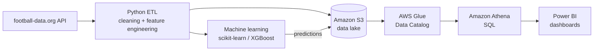

## Tech Stack

| Layer | Tools |
|---|---|
| Data source | football-data.org API (free tier) |
| Data processing | Python, pandas, NumPy, requests |
| Notebook visuals | Matplotlib, Seaborn |
| Machine learning | scikit-learn (Logistic Regression, Random Forest), XGBoost |
| Cloud | AWS S3, Glue, Athena, IAM, boto3, s3fs, AWS CLI |
| BI | Power BI Desktop, Amazon Athena ODBC driver, DAX |

---

# Results

## Power BI Dashboards

Power BI connects to the Athena tables through an ODBC data source. Dashboards cover the league overview, individual team performance, attack, defense, model predictions, and a season simulation.

### Executive Overview

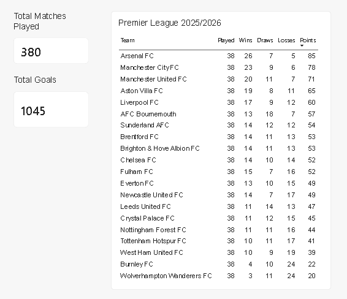

### Team Performance

A team slicer filters rolling form and goals scored versus conceded.

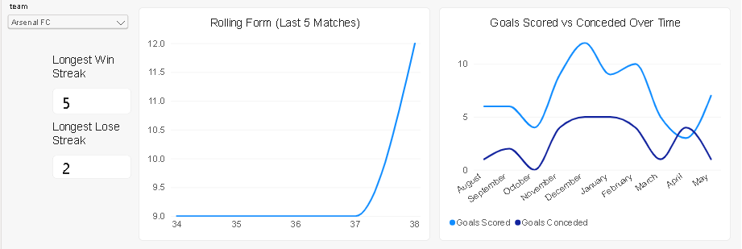

### Offensive

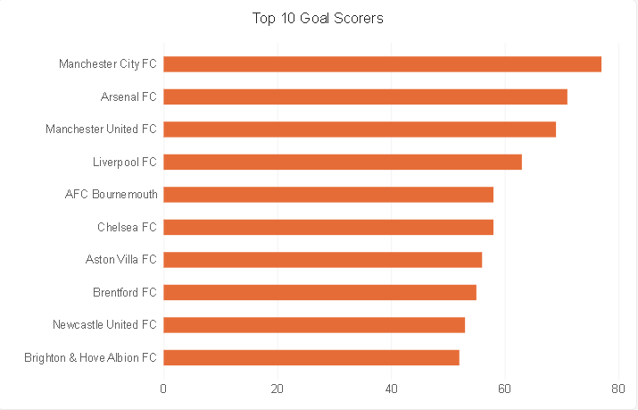
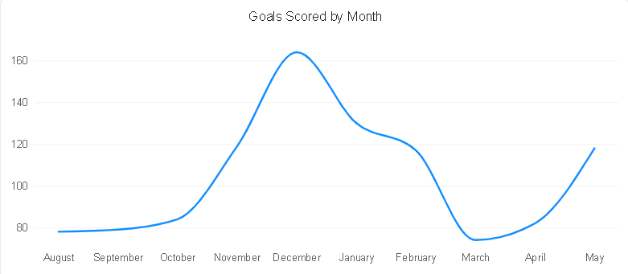
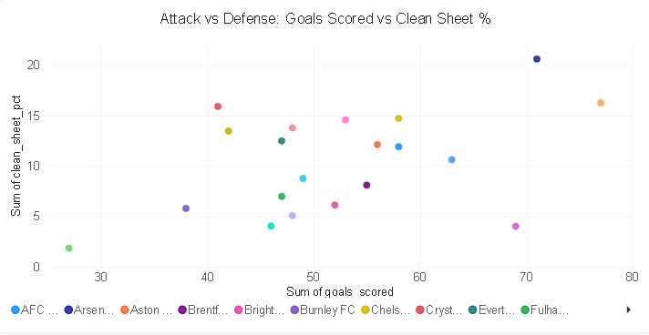

### Defensive

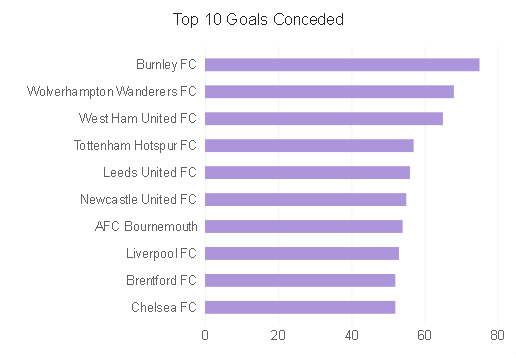
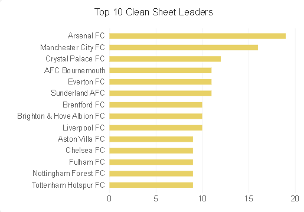
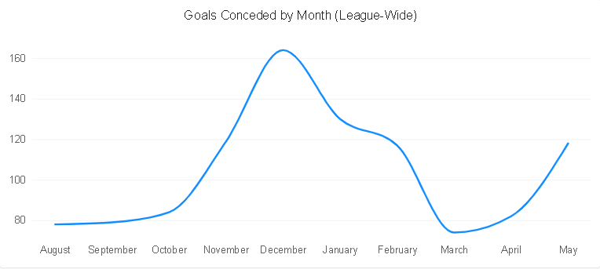

### Prediction

Predictions on the 222-match held-out test set (mid-December 2025 to May 2026): the most recent 20% of matches, which the model never saw during training. Overall accuracy is 43.69%.

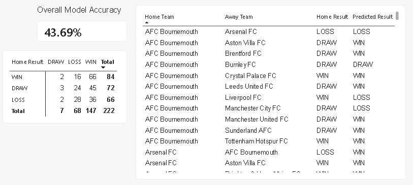

### Season Simulation

The trained Logistic Regression model is used in `notebooks/08_season_simulation.ipynb` to simulate a season, and the output is shown in the pages below.

<!-- TODO: add 2-3 sentences here: what is simulated, how many simulations are run, what inputs are used, and what these pages show. -->

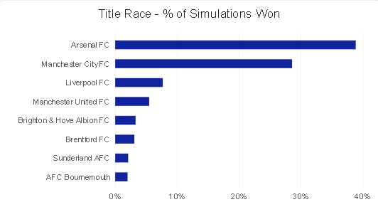
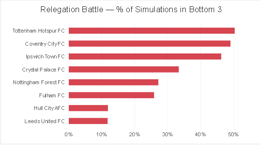
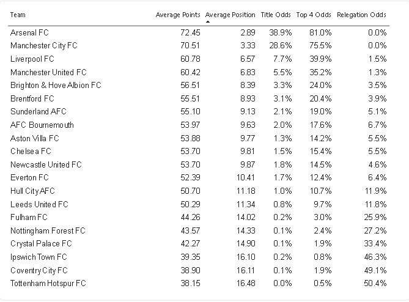

## SQL Analytics (Amazon Athena)

SQL queries run against the Glue-cataloged data lake and cover top scorers, best defenses, home and away win rates, highest-scoring matches, league table reconstruction, rolling form, win streaks, home/away gaps, and clean sheet leaders.

## Machine Learning: Match Outcome Prediction

**Setup:** 1,110 matches with 18 pre-match features for the home and away team (rolling form, win/loss streaks, average goals scored and conceded, clean sheet rate, days since last match, head-to-head win rate, and prior-season league position). The target is the home team's result (win, draw, or loss). The split is **time-based**: 888 matches for training and the 222 most recent matches held out for testing, so the model never trains on future data.

| Model | Accuracy | Draw recall |
|---|---|---|
| **Logistic Regression** (selected) | **43.7%** | 0.04 |
| Random Forest | 41.9% | 0.00 |
| XGBoost | 39.2% | 0.04 |
| *Baseline: always predict a home win* | *37.8%* | *0.00* |

### Confusion Matrix (Logistic Regression)

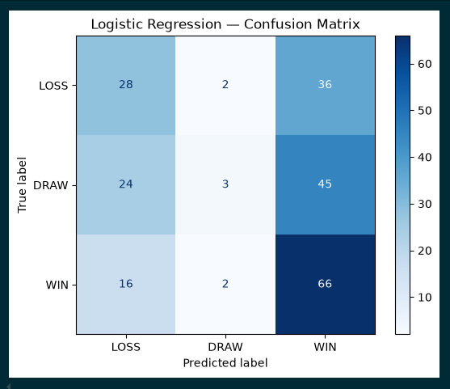

### Feature Importance

Permutation importance on the test set for the selected model (how much accuracy drops when a feature is shuffled):

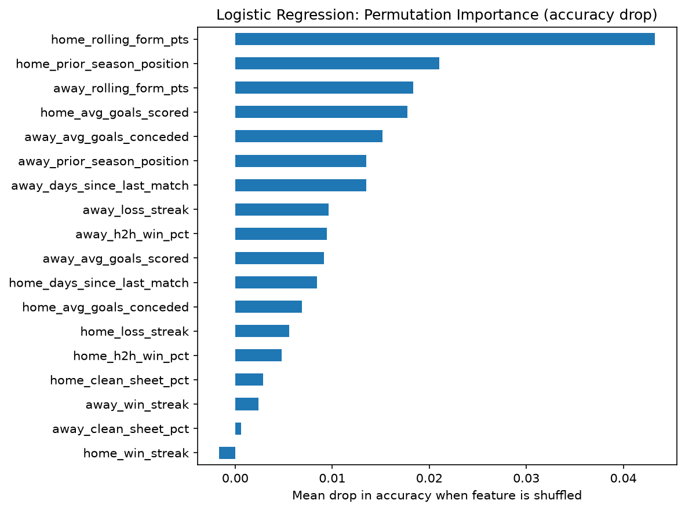

- **Recent form matters most.** `home_rolling_form_pts` is the strongest feature by a wide margin (about 4.3 points of accuracy), and `away_rolling_form_pts` ranks third.
- **Prior-season league position** is the second strongest signal for the home team (about 2.1 points) and also contributes for the away team (about 1.4 points).
- **Average goals scored and conceded** come next.
- **Win streaks and clean sheet rate** contribute almost nothing. `home_win_streak` is slightly negative, meaning shuffling it does not hurt the model.
- With only 222 test matches, one match is about 0.45 points of accuracy, so only the top few rankings are reliable.

## Conclusions

1. **The pipeline works end to end:** API, S3, Glue, Athena, and Power BI, with a time-based machine learning evaluation on top.
2. **Logistic Regression performed best.** It beat the always-predict-home-win baseline by about 6 points. Random Forest (+4) and XGBoost (+1.4) added little or nothing, and the differences between the models are small relative to the noise in a 222-match test set. The simpler, more interpretable model was selected.
3. **Recent form and a team's standing carry the most signal** among the features tested. Streaks and clean sheet rate add almost nothing once form and goal averages are included.
4. **Draws are effectively unpredictable with these features.** The selected model made only 7 draw predictions across 222 matches and got 3 of the 72 actual draws right, and Random Forest never predicted a draw. A draw has no distinct statistical signature in form and goal averages, which is a known difficulty in football prediction.
5. **Accuracy is modest, and it is reported as such.** With 888 training matches and team-level aggregate statistics only, the ceiling is low.

## Limitations

- The free football-data.org tier allows only the three most recent seasons and 10 requests per minute.
- Cards, fouls, referee, and venue data are not available on the free tier, so those analyses were not possible.
- The model uses team-level aggregates only: no player, lineup, injury, or betting-odds data.
- The 222-match test set gives noisy accuracy estimates (roughly plus or minus 3 points).

---

# Project Structure

```
pl-analytics/
├── data/
│   ├── raw/            # raw API pulls
│   ├── processed/      # cleaned match data
│   └── features/       # engineered features and model predictions
├── notebooks/          # 01 to 08, run in order
├── lambda/             # AWS Lambda function code
├── reports/
│   └── screenshots/    # images used in this README
├── requirements.txt
├── requirements-dev.txt
├── .gitignore
├── .env                # local secrets (not committed)
└── README.md
```

# Troubleshooting

| Problem | Fix |
|---|---|
| PowerShell says running scripts is disabled when activating the venv | Run `Set-ExecutionPolicy -Scope Process -ExecutionPolicy Bypass`, then activate again |
| `aws` command not found | The venv is not active. Look for `(.venv)` at the start of the prompt |
| `FileNotFoundError` for `../data/...` in a notebook | Run the notebook from the `notebooks/` folder and check the location with `os.getcwd()` |
| `NameError` or `ModuleNotFoundError` right after opening a notebook | The kernel restarted. Select the `.venv` kernel and use **Run All** |
| Duplicate rows or IDs in an Athena table | More than one file is under the table's S3 folder. Keep one dataset per folder |
| `NoCredentialsError` from boto3 | Run `aws configure` on this machine and check that `.env` exists |
| Athena rejects a script with several statements | Run one statement at a time |
| ODBC driver not listed when adding a DSN | You opened the 32-bit administrator. Use `C:\Windows\System32\odbcad32.exe` |
| Power BI shows an "AAD Authentication" or WAM error | Ignore it and choose **Use Data Source Configuration** |
| Power BI date axis shows full timestamps or sorts wrongly | The API timestamp loads as text because of the `+00:00` suffix. Create a clean date column and sort the month label by a numeric year-month column |

# Data Source

Match data comes from [football-data.org](https://www.football-data.org/) (free tier).